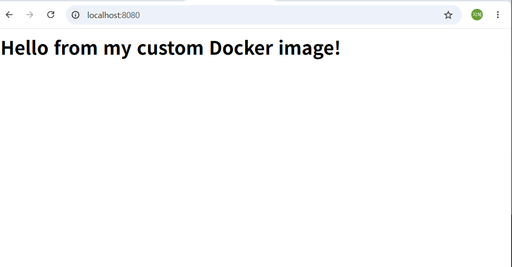

# 개발 워크스테이션 구축 미션

## 1. 프로젝트 개요
터미널(리눅스 CLI), Docker, Git/GitHub를 직접 손으로 세팅하고 사용해 보며,
재현 가능한 개발 환경을 만드는 미션입니다.

## 2. 실행 환경
| 항목 | 내용 |
|---|---|
| OS | Ubuntu 26.04.1 LTS (WSL 2, Windows) |
| 쉘/터미널 | bash / VSCode 터미널 |
| Docker | Docker version 29.9.2, build a82e528 |
| Git | git version 2.53.0 |

## 3. 수행 항목 체크리스트
- [x] 터미널 조작 (위치/목록/이동/생성/복사/이동/삭제/내용 확인)
- [x] 파일/디렉토리 권한 실습 (chmod)
- [x] Docker 설치 및 점검 (version, info)
- [x] Docker 기본 운영 (images, ps, logs, stats)
- [x] hello-world 및 ubuntu 컨테이너 실행
- [x] Dockerfile 기반 커스텀 이미지 (nginx:alpine)
- [x] 포트 매핑 (8080:80)
- [x] 바인드 마운트
- [x] Docker 볼륨 영속성
- [x] Git 설정
- [x] GitHub/VSCode 연동

## 4. 검증 방법과 증거
각 항목마다 "어떤 명령으로 무엇을 확인했는지"와 증거(스크린샷) 링크를 정리했습니다.

### 4-1. Docker 설치 및 점검
| 확인 내용 | 명령어 | 확인한 결과 | 증거 |
|---|---|---|---|
| Docker 버전 | `docker --version` | Docker version 29.9.2 출력 | [01](screenshots/01-docker-version.png) |
| Docker 엔진 동작 | `docker info` | Server Version이 출력되어 엔진이 켜져 있음 | [02](screenshots/02-docker-info.png) |

### 4-2. Docker 기본 운영
| 확인 내용 | 명령어 | 확인한 결과 | 증거 |
|---|---|---|---|
| 이미지 받기/목록 | `docker pull hello-world`, `docker images` | hello-world 이미지가 목록에 보임 | [03](screenshots/03-docker-pull-images.png) |
| 컨테이너 실행/목록 | `docker run hello-world`, `docker ps`, `docker ps -a` | 환영 메시지 출력, 종료된 컨테이너는 ps -a에서만 보임 | [04](screenshots/04-docker-run-hello.png), [05](screenshots/05-docker-ps-a.png) |
| 로그 확인 | `docker logs my-nginx` | nginx 시작 기록이 출력됨 | [06](screenshots/06-docker-logs.png) |
| 리소스 확인 | `docker stats --no-stream` | CPU/메모리 사용량 표가 출력됨 | [07](screenshots/07-docker-stats.png) |
| 우분투 컨테이너 | `docker run -it --name my-ubuntu ubuntu` | 컨테이너 안에서 ls, echo 실행 성공 | [08](screenshots/08-ubuntu-container.png) |
| 종료/유지 차이 | `docker exec -it my-nginx bash` | exit 후에도 컨테이너가 Up 상태로 유지됨 | [09](screenshots/09-exec-vs-exit.png) |

### 4-3. 커스텀 이미지 (nginx:alpine 기반)
| 확인 내용 | 명령어 | 확인한 결과 | 증거 |
|---|---|---|---|
| Dockerfile 작성 | `cat Dockerfile` | FROM, COPY 두 줄 확인 ([app/Dockerfile](app/Dockerfile)) | [10](screenshots/10-dockerfile.png) |
| 이미지 빌드 | `docker build -t my-custom-nginx .` | 빌드 성공, docker images에 표시 | [11](screenshots/11-docker-build.png) |
| 컨테이너 실행 | `docker run -d --name my-custom-web my-custom-nginx` | 컨테이너 안에서 내 페이지 응답 확인 | [12](screenshots/12-custom-container-run.png) |

### 4-4. 포트 매핑
| 확인 내용 | 명령어 | 확인한 결과 | 증거 |
|---|---|---|---|
| 포트 연결 | `docker run -d -p 8080:80 ...`, `curl http://localhost:8080` | 내 컴퓨터 8080 포트로 접속 성공 | [13](screenshots/13-port-mapping-curl.png) |
| 브라우저 접속 | 주소창에 `http://localhost:8080` 입력 | 주소창과 페이지가 함께 보임 | [14](screenshots/14-browser-8080.png) |



### 4-5. 바인드 마운트
| 확인 내용 | 명령어 | 확인한 결과 | 증거 |
|---|---|---|---|
| 변경 전 | `docker run -d -p 8081:80 -v $HOME/bind-site:/usr/share/nginx/html nginx:alpine` | Version 1 (before) 표시 | [15](screenshots/15-bind-mount-before.png) |
| 변경 후 | `echo "<h1>Version 2 (after)</h1>" > ~/bind-site/index.html` | 컨테이너 재시작 없이 Version 2 (after) 표시 | [16](screenshots/16-bind-mount-after.png), [17](screenshots/17-bind-mount-browser.png) |

### 4-6. Docker 볼륨 영속성
| 확인 내용 | 명령어 | 확인한 결과 | 증거 |
|---|---|---|---|
| 볼륨 생성/연결/데이터 입력 | `docker volume create my-data`, `docker run -d --name vol-test -v my-data:/data alpine sleep 3600` | note.txt에 데이터 저장됨 | [18](screenshots/18-volume-before.png) |
| 컨테이너 삭제 후 확인 | `docker rm -f vol-test`, `docker run --rm -v my-data:/data alpine cat /data/note.txt` | 컨테이너 삭제 후에도 데이터가 남아 있음 | [19](screenshots/19-volume-after.png) |

### 4-7. Git 설정 및 GitHub 연동
| 확인 내용 | 명령어 | 확인한 결과 | 증거 |
|---|---|---|---|
| Git 설정 | `git config --list` | user.name, user.email, init.defaultbranch=main 확인 | [20](screenshots/20-git-config.png) |
| VSCode와 WSL 연결 | `code .` | 왼쪽 아래에 WSL: Ubuntu 표시 | [21](screenshots/21-vscode-wsl.png) |
| GitHub 로그인 | VSCode 계정 메뉴 | 내 GitHub 아이디 표시 | [22](screenshots/22-vscode-github-login.png) |
| 저장소 연동 | `git clone`, `git remote -v` | origin 주소 확인 | [23](screenshots/23-git-clone-remote.png), [24](screenshots/24-vscode-repo-connected.png) |

> 터미널 조작과 권한 실습의 명령어와 출력은 아래 "5. 터미널 조작 로그"에 기록했습니다.

### 4-8. Docker 명령 실행 로그

**설치 확인 (`docker --version`)**
```bash
(wymm01@DESKTOP-9LTHJF0:~/practice$ docker --version
Docker version 29.9.2, build a82e528)
```

**엔진 동작 점검 (`docker info`)**
```bash
(wymm01@DESKTOP-9LTHJF0:~/practice$ docker info
Client:
 Version:    29.9.2
 Context:    default
 Debug Mode: false
 Plugins:
  agent: Docker AI Agent Runner (Docker Inc.)
    Version:  v1.152.0
    Path:     /usr/local/lib/docker/cli-plugins/docker-agent
  ai: Docker AI Agent - Ask Gordon (Docker Inc.)
    Version:  v1.33.0
    Path:     /usr/local/lib/docker/cli-plugins/docker-ai
  buildx: Docker Buildx (Docker Inc.)
    Version:  v0.38.1
    Path:     /usr/local/lib/docker/cli-plugins/docker-buildx
  compose: Docker Compose (Docker Inc.)
    Version:  v5.6.1
    Path:     /usr/local/lib/docker/cli-plugins/docker-compose
  debug: Get a shell into any image or container (Docker Inc.)
    Version:  0.49.0
    Path:     /usr/local/lib/docker/cli-plugins/docker-debug
  desktop: Docker Desktop commands (Docker Inc.)
    Version:  4.96.3
    Path:     /usr/local/lib/docker/cli-plugins/docker-desktop
  dhi: CLI for managing Docker Hardened Images (Docker Inc.)
    Version:  v0.0.9
    Path:     /usr/local/lib/docker/cli-plugins/docker-dhi
  extension: Manages Docker extensions (Docker Inc.)
    Version:  v0.2.32
    Path:     /usr/local/lib/docker/cli-plugins/docker-extension
  init: Creates Docker-related starter files for your project (Docker Inc.)
    Version:  v1.4.1
    Path:     /usr/local/lib/docker/cli-plugins/docker-init
  mcp: Docker MCP Plugin (Docker Inc.)
    Version:  v0.44.2
    Path:     /usr/local/lib/docker/cli-plugins/docker-mcp
  model: Docker Model Runner (Docker Inc.)
    Version:  v1.2.9
    Path:     /usr/local/lib/docker/cli-plugins/docker-model
  offload: Docker Offload (Docker Inc.)
    Version:  v0.7.19
    Path:     /usr/local/lib/docker/cli-plugins/docker-offload
  pass: Docker Pass Secrets Manager Plugin (beta) (Docker Inc.)
    Version:  v0.3.2
    Path:     /usr/local/lib/docker/cli-plugins/docker-pass
  sandbox: "docker sandbox" is deprecated, use Docker Sandboxes instead (Docker Inc.)
    Version:  v0.13.0
    Path:     /usr/local/lib/docker/cli-plugins/docker-sandbox
  scout: Docker Scout (Docker Inc.)
    Version:  v1.27.0
    Path:     /usr/local/lib/docker/cli-plugins/docker-scout

Server:
 Containers: 3
  Running: 0
  Paused: 0
  Stopped: 3
 Images: 2
 Server Version: 29.9.2
 Storage Driver: overlayfs
  driver-type: io.containerd.snapshotter.v1
 Logging Driver: local
 Cgroup Driver: cgroupfs
 Cgroup Version: 2
 Plugins:
  Volume: local
  Network: bridge host ipvlan macvlan null overlay
  Log: awslogs fluentd gcplogs gelf journald json-file local splunk syslog
 CDI spec directories:
  /etc/cdi
  /var/run/cdi
 Discovered Devices:
  cdi: docker.com/gpu=webgpu
 Swarm: inactive
 Runtimes: io.containerd.runc.v2 nvidia runc
 Default Runtime: runc
 Init Binary: docker-init
 containerd version: b7a25261e029d68978bbf290df0a62fc819b3c51
 runc version: v1.5.2-0-g29dd3dc2
 init version: de40ad0
 Security Options:
  seccomp
   Profile: builtin
  cgroupns
 Kernel Version: 6.18.54.1-microsoft-standard-WSL2
 Operating System: Docker Desktop
 OSType: linux
 Architecture: x86_64
 CPUs: 8
 Total Memory: 3.681GiB
 Name: docker-desktop
 ID: 38556747-0678-4710-99b5-127ac2be444a
 Docker Root Dir: /var/lib/docker
 Debug Mode: false
 HTTP Proxy: http.docker.internal:3128
 HTTPS Proxy: http.docker.internal:3128
 No Proxy: hubproxy.docker.internal
 Labels:
  com.docker.desktop.address=unix:///var/run/docker-cli.sock
 Experimental: false
 Insecure Registries:
  hubproxy.docker.internal:5555
  127.0.0.0/8
  ::1/128
 Live Restore Enabled: false
 Firewall Backend: iptables)
```

**이미지 받기와 목록 (`docker pull`, `docker images`)**
```bash
(wymm01@DESKTOP-9LTHJF0:~/practice$ docker pull hello-world
Using default tag: latest
latest: Pulling from library/hello-world
Digest: sha256:c567b231f65614688711a75f31518a064258a51d442117a3e771a3a8fdba78ef
Status: Downloaded newer image for hello-world:latest
docker.io/library/hello-world:latest
wymm01@DESKTOP-9LTHJF0:~/practice$ docker images
                                                                                                    i Info →   U  In Use
IMAGE                ID             DISK USAGE   CONTENT SIZE   EXTRA
hello-world:latest   c567b231f656       25.9kB         9.49kB    U
ubuntu:latest        c098726dd9b9        163MB         45.9MB    U)
```

**hello-world 실행과 컨테이너 목록 (`docker run`, `docker ps`, `docker ps -a`)**
```bash
(wymm01@DESKTOP-9LTHJF0:~/practice$ docker ps
CONTAINER ID   IMAGE     COMMAND   CREATED   STATUS    PORTS     NAMES
wymm01@DESKTOP-9LTHJF0:~/practice$ docker ps -a
CONTAINER ID   IMAGE          COMMAND    CREATED              STATUS                          PORTS     NAMES
37c238433050   hello-world    "/hello"   About a minute ago   Exited (0) About a minute ago             determined_villani
6a29715c3495   ubuntu         "bash"     7 days ago           Exited (137) 7 days ago                   myubuntu
b144a5bfb216   ubuntu         "bash"     7 days ago           Exited (0) 7 days ago                     determined_proskuriakova
a3d897962f35   11a3eb1597e8   "/hello"   7 days ago           Exited (0) 7 days ago                     clever_pascal
wymm01@DESKTOP-9LTHJF0:~/practice$ docker run -d --name my-nginx nginx
Unable to find image 'nginx:latest' locally
latest: Pulling from library/nginx
a670537bed70: Pull complete
6fc242d221a6: Pull complete
d322f1bf41d8: Pull complete
9f604dae09b2: Pull complete
6e2ab1f3ef4e: Pull complete
a071113ac575: Pull complete
c139fe92686d: Pull complete
05a7d8870b4b: Download complete
ca81da665177: Download complete
Digest: sha256:600f7cd45e27aa13e9304c834ab7c1b0ff39df85ee1dcc5087955455d77bc83b
Status: Downloaded newer image for nginx:latest
10a11dde4662aa1b61571cd02c9bef7a8ed5c96fd020d90212b00216d74a74f0
)
```

**로그 확인 (`docker logs`)**
```bash
(wymm01@DESKTOP-9LTHJF0:~/practice$ docker logs my-nginx
/docker-entrypoint.sh: /docker-entrypoint.d/ is not empty, will attempt to perform configuration
/docker-entrypoint.sh: Looking for shell scripts in /docker-entrypoint.d/
/docker-entrypoint.sh: Launching /docker-entrypoint.d/10-listen-on-ipv6-by-default.sh
10-listen-on-ipv6-by-default.sh: info: Getting the checksum of /etc/nginx/conf.d/default.conf
10-listen-on-ipv6-by-default.sh: info: Enabled listen on IPv6 in /etc/nginx/conf.d/default.conf
/docker-entrypoint.sh: Sourcing /docker-entrypoint.d/15-local-resolvers.envsh
/docker-entrypoint.sh: Launching /docker-entrypoint.d/20-envsubst-on-templates.sh
/docker-entrypoint.sh: Launching /docker-entrypoint.d/30-tune-worker-processes.sh
/docker-entrypoint.sh: Configuration complete; ready for start up
2026/10/30 13:53:54 [notice] 1#1: using the "epoll" event method
2026/10/30 13:53:54 [notice] 1#1: nginx/1.31.8
2026/10/30 13:53:54 [notice] 1#1: built by gcc 14.2.0 (Debian 14.2.0-19)
2026/10/30 13:53:54 [notice] 1#1: OS: Linux 6.18.54.1-microsoft-standard-WSL2
2026/10/30 13:53:54 [notice] 1#1: getrlimit(RLIMIT_NOFILE): 1048576:1048576
2026/10/30 13:53:54 [notice] 1#1: start worker processes
2026/10/30 13:53:54 [notice] 1#1: start worker process 29
2026/10/30 13:53:54 [notice] 1#1: start worker process 30
2026/10/30 13:53:54 [notice] 1#1: start worker process 31
2026/10/30 13:53:54 [notice] 1#1: start worker process 32
2026/10/30 13:53:54 [notice] 1#1: start worker process 33
2026/10/30 13:53:54 [notice] 1#1: start worker process 34
2026/10/30 13:53:54 [notice] 1#1: start worker process 35
2026/10/30 13:53:54 [notice] 1#1: start worker process 36
)
```

**리소스 확인 (`docker stats`)**
```bash
(wymm01@DESKTOP-9LTHJF0:~/practice$ docker stats --no-stream
CONTAINER ID   NAME       CPU %     MEM USAGE / LIMIT    MEM %     NET I/O         BLOCK I/O     PIDS
10a11dde4662   my-nginx   0.00%     7.77MiB / 3.681GiB   0.21%     1.17kB / 126B   0B / 12.3kB   9
)
```

**우분투 컨테이너 실행과 종료/유지 차이 (`docker run -it`, `docker exec`)**
```bash
(wymm01@DESKTOP-9LTHJF0:~/practice$ docker run -it --name my-ubuntu ubuntu
root@1165e7187a5a:/# ls
bin  boot  dev  etc  home  lib  lib64  media  mnt  opt  proc  root  run  sbin  srv  sys  tmp  usr  var
root@1165e7187a5a:/# echo "hello from ubuntu container"
hello from ubuntu container
root@1165e7187a5a:/# exit
exit
)
```
```bash
(wymm01@DESKTOP-9LTHJF0:~/practice$ docker exec -it my-nginx bash
root@10a11dde4662:/# ls
bin   dev                  docker-entrypoint.sh  home  lib64  mnt  proc  run   srv  tmp  var
boot  docker-entrypoint.d  etc                   lib   media  opt  root  sbin  sys  usr
root@10a11dde4662:/# exit
exit
)
```

**커스텀 이미지 빌드와 실행 (`docker build`, `docker run`)**
```bash
(wymm01@DESKTOP-9LTHJF0:~/my-web$ docker build -t my-custom-nginx .
[+] Building 22.2s (7/7) FINISHED               docker:default
 => [internal] load build definition from Dockerfile      0.5s
 => => transferring dockerfile: 104B                      0.1s
 => [internal] load metadata for docker.io/library/nginx  5.0s
 => [internal] load .dockerignore                         0.4s
 => => transferring context: 2B                           0.0s
 => [internal] load build context                         0.7s
 => => transferring context: 81B                          0.0s
 => [1/2] FROM docker.io/library/nginx:alpine@sha256:785  8.8s
 => => resolve docker.io/library/nginx:alpine@sha256:785  0.4s
 => => sha256:9b0f7dfe35b2711a17f60dadd6 1.40kB / 1.40kB  0.4s
 => => sha256:b9b388a21ecfde6ac80505f2 20.53MB / 20.53MB  4.0s
 => => sha256:2ec5fb117ffa9a78b15fb6a787 1.21kB / 1.21kB  0.6s
 => => sha256:26185d08a3ec318dd85a6c9f2172e7 404B / 404B  0.6s
 => => sha256:7cc330898115ce55acccb0cc1e7dd0 964B / 964B  0.6s
 => => sha256:657023555a2a19dc6036468198bb35 629B / 629B  0.5s
 => => sha256:12b85cff06fd7d383d36a9c965 1.94MB / 1.94MB  1.2s
 => => sha256:7b229517ed222597277036d948 3.85MB / 3.85MB  1.4s
 => => extracting sha256:7b229517ed222597277036d94892173  0.6s
 => => extracting sha256:12b85cff06fd7d383d36a9c96503fe0  0.5s
 => => extracting sha256:657023555a2a19dc6036468198bb350  0.4s
 => => extracting sha256:7cc330898115ce55acccb0cc1e7dd09  0.3s
 => => extracting sha256:26185d08a3ec318dd85a6c9f2172e71  0.2s
 => => extracting sha256:2ec5fb117ffa9a78b15fb6a78745ffc  0.2s
 => => extracting sha256:9b0f7dfe35b2711a17f60dadd6d4035  0.2s
 => => extracting sha256:b9b388a21ecfde6ac80505f23f52714  0.7s
 => [2/2] COPY index.html /usr/share/nginx/html/index.ht  0.8s
 => exporting to image                                    5.0s
 => => exporting layers                                   1.1s
 => => exporting manifest sha256:c9ac3c510cc5ec0839cb97a  0.2s
 => => exporting config sha256:9cc9c8a94d5c289955b724da0  0.2s
 => => exporting attestation manifest sha256:4935332e0f7  0.5s
 => => exporting manifest list sha256:7fc62c7dc411a8c113  0.2s
 => => naming to docker.io/library/my-custom-nginx:lates  0.0s
 => => unpacking to docker.io/library/my-custom-nginx:la  2.4s
wymm01@DESKTOP-9LTHJF0:~/my-web$ docker images
                                           i Info →   U  In Use
IMAGE          ID             DISK USAGE   CONTENT SIZE   EXTRA
hello-world:latest
               c567b231f656       25.9kB         9.49kB    U
my-custom-nginx:latest
               7fc62c7dc411       93.6MB         26.3MB
nginx:latest   600f7cd45e27        243MB         66.8MB    U
ubuntu:latest
               c098726dd9b9        163MB         45.9MB    U
)
```
```bash
(wymm01@DESKTOP-9LTHJF0:~/my-web$ docker run -d --name my-custom-web my-custom-nginx
0d652377ef94f355184a79edc3067644930b345222c024c13e70a0711215cfd6
)
```

**포트 매핑 (`-p 8080:80`)**
```bash
(wymm01@DESKTOP-9LTHJF0:~/my-web$ docker rm -f my-custom-web
my-custom-web
wymm01@DESKTOP-9LTHJF0:~/my-web$ docker run -d --name my-custom-web -p 8080:80 my-custom-nginx
d70e11854677b149dbc0bb44bb39ee1a2860c57c0fcc7a361c6c00a200301885
wymm01@DESKTOP-9LTHJF0:~/my-web$ docker ps
CONTAINER ID   IMAGE             COMMAND                  CREATED          STATUS          PORTS                                     NAMES
d70e11854677   my-custom-nginx   "/docker-entrypoint.…"   17 seconds ago   Up 15 seconds   0.0.0.0:8080->80/tcp, [::]:8080->80/tcp   my-custom-web
wymm01@DESKTOP-9LTHJF0:~/my-web$ curl http://localhost:8080
<h1>Hello from my custom Docker image!</h1>
)
```

**바인드 마운트 (변경 전/후)**
```bash
(wymm01@DESKTOP-9LTHJF0:~/my-web$ mkdir ~/bind-site
wymm01@DESKTOP-9LTHJF0:~/my-web$ echo "<h1>Version 1 (before)</h1>" > ~/bind-site/index.html
wymm01@DESKTOP-9LTHJF0:~/my-web$ cat ~/bind-site/index.html
<h1>Version 1 (before)</h1>
wymm01@DESKTOP-9LTHJF0:~/my-web$ docker run -d --name my-bind-web -p 8081:80 -v $HOME/bind-site:/usr/share/nginx/html nginx:alpine
Unable to find image 'nginx:alpine' locally
alpine: Pulling from library/nginx
Digest: sha256:785835ea65db4bba6f021acc0f3be91b0fef76a53fe41f8588c6698d2aed0606
Status: Downloaded newer image for nginx:alpine
99c7986c86f62a1f6b3fa684a52038cd5aab8bc4a3a6a6b07ef26e0618816237
wymm01@DESKTOP-9LTHJF0:~/my-web$ curl http://localhost:8081
<h1>Version 1 (before)</h1>
)
```
```bash
(wymm01@DESKTOP-9LTHJF0:~/my-web$ echo "<h1>Version 2 (after)</h1>" > ~/bind-site/index.html
wymm01@DESKTOP-9LTHJF0:~/my-web$ cat ~/bind-site/index.html
<h1>Version 2 (after)</h1>
wymm01@DESKTOP-9LTHJF0:~/my-web$ curl http://localhost:8081
<h1>Version 2 (after)</h1>
)
```

**Docker 볼륨 (컨테이너 삭제 전/후)**
```bash
(wymm01@DESKTOP-9LTHJF0:~/my-web$ docker volume create my-data
my-data
wymm01@DESKTOP-9LTHJF0:~/my-web$ docker volume ls
DRIVER    VOLUME NAME
local     my-data
wymm01@DESKTOP-9LTHJF0:~/my-web$ docker run -d --name vol-test -v my-data:/data alpine sleep 3600
Unable to find image 'alpine:latest' locally
latest: Pulling from library/alpine
7b229517ed22: Already exists
3da1513d2124: Download complete
3ec36f3670df: Download complete
Digest: sha256:be2656061b536c1883c4034790e21d0a09c5aaaf51968b89368a3c0371ea2c9a
Status: Downloaded newer image for alpine:latest
271fa580ba61112872a6838820ca7ea63feebbe09b4fe0fa2be19abe5c14703c
wymm01@DESKTOP-9LTHJF0:~/my-web$ docker exec vol-test sh -c "echo 'I survive container deletion' > /data/note.txt"
wymm01@DESKTOP-9LTHJF0:~/my-web$ docker exec vol-test cat /data/note.txt
I survive container deletion
)
```
```bash
(wymm01@DESKTOP-9LTHJF0:~/my-web$ docker rm -f vol-test
vol-test
wymm01@DESKTOP-9LTHJF0:~/my-web$ docker ps -a
CONTAINER ID   IMAGE             COMMAND                  CREATED          STATUS                     PORTS                                     NAMES
99c7986c86f6   nginx:alpine      "/docker-entrypoint.…"   16 minutes ago   Up 16 minutes              0.0.0.0:8081->80/tcp, [::]:8081->80/tcp   my-bind-web
d70e11854677   my-custom-nginx   "/docker-entrypoint.…"   34 minutes ago   Up 34 minutes              0.0.0.0:8080->80/tcp, [::]:8080->80/tcp   my-custom-web
1165e7187a5a   ubuntu            "/bin/bash"              21 hours ago     Exited (0) 21 hours ago                                              my-ubuntu
10a11dde4662   nginx             "/docker-entrypoint.…"   21 hours ago     Exited (255) 2 hours ago   80/tcp                                    my-nginx
37c238433050   hello-world       "/hello"                 21 hours ago     Exited (0) 21 hours ago                                              determined_villani
6a29715c3495   ubuntu            "bash"                   8 days ago       Exited (137) 8 days ago                                              myubuntu
b144a5bfb216   ubuntu            "bash"                   8 days ago       Exited (0) 8 days ago                                                determined_proskuriakova
a3d897962f35   11a3eb1597e8      "/hello"                 8 days ago       Exited (0) 8 days ago                                                clever_pascal
wymm01@DESKTOP-9LTHJF0:~/my-web$ docker volume ls
DRIVER    VOLUME NAME
local     my-data
wymm01@DESKTOP-9LTHJF0:~/my-web$ docker run --rm -v my-data:/data alpine cat /data/note.txt
I survive container deletion
)
```

**Git 설정 (`git config --list`)**
```bash
(wymm01@DESKTOP-9LTHJF0:~/my-web$ git config --global user.name "
wymm01"
wymm01@DESKTOP-9LTHJF0:~/my-web$ git config --global user.email "wymm0110@naver.com"
wymm01@DESKTOP-9LTHJF0:~/my-web$ git config --global init.defaultBranch main
wymm01@DESKTOP-9LTHJF0:~/my-web$ git config --list
user.name=wymm01
user.email=wymm0110@naver.com
init.defaultbranch=main
)
```

## 5. 터미널 조작 로그
> 처음 시도할 때 남긴 로그는 [logs/first-attempt-log.md](logs/first-attempt-log.md)에 보관했습니다.

### 5-1. 터미널 기본 조작

**현재 위치 확인 (`pwd`)**
```bash
(/home/wymm01/)
```

**목록 확인, 숨김 파일 포함 (`ls -a`)**
```bash
(.  ..  .aws  .azure  .bash_history  .bash_logout  .bashrc  .cache  .config  .docker  .motd_shown  .profile  practice)
```

**폴더 만들기, 이동 (`mkdir`, `cd`)**
```bash
(wymm01@DESKTOP-9LTHJF0:~$ mkdir practice
mkdir: practice: File exists
wymm01@DESKTOP-9LTHJF0:~$ cd practice
wymm01@DESKTOP-9LTHJF0:~/practice$ pwd
/home/wymm01/practice
)
```

**빈 파일 만들기, 내용 쓰기, 내용 확인 (`touch`, `echo`, `cat`)**
```bash
(wymm01@DESKTOP-9LTHJF0:~/practice$ touch empty.txt
wymm01@DESKTOP-9LTHJF0:~/practice$ echo "hello linux" > hello.txt
wymm01@DESKTOP-9LTHJF0:~/practice$ ls
empty.txt  folder1  hello.txt
wymm01@DESKTOP-9LTHJF0:~/practice$ cat hello.txt
hello linux
)
```

**복사, 이름 바꾸기, 이동 (`cp`, `mv`)**
```bash
(wymm01@DESKTOP-9LTHJF0:~/practice$ cp hello.txt copy.txt
wymm01@DESKTOP-9LTHJF0:~/practice$ mv copy.txt renamed.txt
wymm01@DESKTOP-9LTHJF0:~/practice$ mkdir folder1
mkdir: folder1: File exists
wymm01@DESKTOP-9LTHJF0:~/practice$ mv renamed.txt folder1/
wymm01@DESKTOP-9LTHJF0:~/practice$ ls
empty.txt  folder1  hello.txt
)
```

**삭제 (`rm`)**
```bash
(wymm01@DESKTOP-9LTHJF0:~/practice$ rm empty.txt
wymm01@DESKTOP-9LTHJF0:~/practice$ mkdir temp_dir
wymm01@DESKTOP-9LTHJF0:~/practice$ rm -r temp_dir
wymm01@DESKTOP-9LTHJF0:~/practice$ ls
folder1  hello.txt
)
```

### 5-2. 권한 실습

**파일 권한 (`hello.txt`)**

변경 전:
```bash
(wymm01@DESKTOP-9LTHJF0:~/practice$ ls -l hello.txt
-rw-r--r-- 1 wymm01 wymm01 12 Oct 30 18:42 hello.txt
wymm01@DESKTOP-9LTHJF0:~/practice$ ls -l
total 8
drwxr-xr-x 2 wymm01 wymm01 4096 Oct 30 18:49 folder1
-rw-r--r-- 1 wymm01 wymm01   12 Oct 30 18:42 hello.txt
)
```
`chmod 000`으로 변경 후:
```bash
(wymm01@DESKTOP-9LTHJF0:~/practice$ chmod 000 hello.txt
wymm01@DESKTOP-9LTHJF0:~/practice$ ls -l hello.txt
---------- 1 wymm01 wymm01 12 Oct 30 18:42 hello.txt
wymm01@DESKTOP-9LTHJF0:~/practice$ cat hello.txt
cat: hello.txt: Permission denied
)
```
`chmod 644`로 되돌린 후:
```bash
(wymm01@DESKTOP-9LTHJF0:~/practice$ chmod 644 hello.txt
wymm01@DESKTOP-9LTHJF0:~/practice$ ls -l hello.txt
-rw-r--r-- 1 wymm01 wymm01 12 Oct 30 18:42 hello.txt
wymm01@DESKTOP-9LTHJF0:~/practice$ cat hello.txt
hello linux
)
```

**폴더 권한 (`folder1`)**

변경 전:
```bash
(wymm01@DESKTOP-9LTHJF0:~/practice$ ls -ld folder1
drwxr-xr-x 2 wymm01 wymm01 4096 Oct 30 18:49 folder1
wymm01@DESKTOP-9LTHJF0:~/practice$ ls -l folder1
total 4
-rw-r--r-- 1 wymm01 wymm01 12 Oct 30 18:46 renamed.txt
)
```
`chmod 000`으로 변경 후:
```bash
(wymm01@DESKTOP-9LTHJF0:~/practice$ chmod 000 folder1
wymm01@DESKTOP-9LTHJF0:~/practice$ ls -ld folder1
d--------- 2 wymm01 wymm01 4096 Oct 30 18:49 folder1
wymm01@DESKTOP-9LTHJF0:~/practice$ cd folder1
-bash: cd: folder1: Permission denied
)
```
`chmod 755`로 되돌린 후:
```bash
(wymm01@DESKTOP-9LTHJF0:~/practice$ chmod 755 folder1
wymm01@DESKTOP-9LTHJF0:~/practice$ ls -ld folder1
drwxr-xr-x 2 wymm01 wymm01 4096 Oct 30 18:49 folder1)
```

## 6. 개념 정리
### 6-1. 절대 경로와 상대 경로
- **절대 경로**: 맨 앞 `/`(루트)부터 시작하는 전체 주소입니다. 어디서 입력해도 같은 곳을 가리킵니다.
  - 예: `/home/wymm01/practice/hello.txt`
- **상대 경로**: 지금 있는 위치를 기준으로 쓰는 주소입니다. `..`은 한 단계 위 폴더입니다.
  - 예: 현재 위치가 `/home/wymm01/practice`일 때 `hello.txt`, `folder1/renamed.txt`
- 같은 파일을 가리키는 두 가지 방법:
  - 절대 경로: `cat /home/wymm01/practice/hello.txt`
  - 상대 경로: `cat hello.txt` (practice 폴더 안에서)

### 6-2. 파일 권한 (r/w/x, 755, 644)
- `r`(read, 읽기)=4, `w`(write, 쓰기)=2, `x`(execute, 실행)=1이며, 합쳐서 숫자 하나로 씁니다.
- 권한은 **주인 / 그룹 / 그 외 사람** 세 부류에게 순서대로 줍니다.
- `644` = 주인 `rw-`(4+2), 그룹 `r--`(4), 그 외 `r--`(4) → 주인만 수정 가능
- `755` = 주인 `rwx`(4+2+1), 그룹 `r-x`(4+1), 그 외 `r-x`(4+1) → 주인만 수정 가능, 모두 실행/진입 가능
- 폴더에서는 `x`가 "그 폴더 안으로 들어가기(cd)"를 뜻합니다. 실습에서 `chmod 000 folder1` 후 `cd folder1`이 Permission denied로 막히는 것을 확인했습니다.

### 6-3. 커스텀 이미지 (기존 베이스 활용)
- **선택한 기존 베이스**: `nginx:alpine` (웹 서버 베이스 이미지 활용 방식)
- **커스텀 포인트와 목적**
  - `FROM nginx:alpine`: 웹 서버가 이미 들어 있고 용량이 작아서 선택했습니다.
  - `COPY index.html /usr/share/nginx/html/index.html`: 기본 화면 대신 내가 만든 페이지를 보여주기 위해 교체했습니다.
- 소스: [app/Dockerfile](app/Dockerfile), [app/index.html](app/index.html)

### 6-4. 포트 매핑이 필요한 이유
- 컨테이너는 격리된 환경이라 밖(내 브라우저)에서 바로 접속할 수 없습니다.
- `-p 8080:80`은 "내 컴퓨터의 8080번 포트로 들어오면 컨테이너의 80번 포트로 연결"해서, 브라우저에서 `http://localhost:8080`으로 접속할 수 있게 합니다.

### 6-5. 이미지와 컨테이너, 종료/유지 차이
- **이미지**는 컨테이너를 만들기 위한 설계도(읽기 전용), **컨테이너**는 그 이미지로 실제 실행되는 인스턴스입니다. 같은 이미지로 컨테이너를 여러 개 만들 수 있습니다.
- `docker run -it ubuntu`로 들어갔다가 `exit`하면 컨테이너도 함께 종료(Exited)됐습니다. 컨테이너의 메인 프로그램이 내가 쓰던 bash였기 때문입니다.
- 이미 실행 중인 컨테이너에 `docker exec -it my-nginx bash`로 들어갔다가 `exit`해도 컨테이너는 계속 실행(Up)됐습니다. 메인 프로그램(nginx)은 그대로 돌고 있었기 때문입니다.

### 6-6. 바인드 마운트와 Docker 볼륨
| 구분 | 바인드 마운트 | Docker 볼륨 |
|---|---|---|
| 저장 위치 | 내가 정한 내 컴퓨터 폴더 | Docker가 관리하는 저장소 |
| 특징 | 내 컴퓨터에서 파일을 고치면 컨테이너에 바로 반영 | 컨테이너를 삭제해도 데이터가 남음(영속성) |
| 실습 | `-v $HOME/bind-site:/usr/share/nginx/html` | `-v my-data:/data` |
| 용도 | 개발할 때 코드 수정 반영 | 데이터 보관 |

### 6-7. Git과 GitHub의 차이
- **Git**: 내 컴퓨터(로컬)에서 파일의 변경 기록을 관리하는 버전 관리 도구입니다.
- **GitHub**: Git으로 만든 기록을 인터넷(원격)에 올려 보관하고, 다른 사람과 협업하는 플랫폼입니다.

## 7. 트러블슈팅
### 7-1. 우분투에서 `docker` 명령어를 찾지 못함
- **문제**: 우분투(WSL)에서 `docker --version`을 입력하니 `The command 'docker' could not be found in this WSL 2 distro.` 오류가 나왔다.
- **원인 가설**: Docker Desktop은 설치되어 있지만, 새로 설치한 우분투와 Docker Desktop의 WSL 연동(integration) 설정이 꺼져 있어서 연결이 안 된 것 같다.
- **확인**: 오류 메시지에 "Docker Desktop 설정에서 WSL integration을 켜라"는 안내가 있었다. Docker Desktop의 Settings → Resources → WSL Integration에서 Ubuntu 스위치가 꺼져 있는 것을 확인했다.
- **해결**: Ubuntu 스위치를 켜고 Apply & restart를 누른 뒤, 우분투 창을 새로 열어 `docker --version`을 다시 실행하니 `Docker version 29.9.2`가 출력되었다.

### 7-2. `wsl` 입력 시 우분투가 아니라 `docker-desktop`으로 들어감
- **문제**: PowerShell에서 `wsl`을 입력했는데 프롬프트가 `docker-desktop:/tmp/...#`로 바뀌었다. 우분투가 아니었다.
- **원인 가설**: 우분투가 아직 설치되지 않아서, 컴퓨터에 있던 Docker Desktop 전용 내부 리눅스(docker-desktop)가 기본으로 열린 것 같다.
- **확인**: 프롬프트에 `docker-desktop`이라고 표시되는 것을 보고, 우분투가 아닌 Docker 내부용 환경임을 알았다.
- **해결**: `exit`로 나온 뒤 `wsl --install -d Ubuntu`로 우분투를 설치했다. 이후 `wsl -d Ubuntu`로 들어가니 프롬프트가 `wymm01@DESKTOP-...:~$`로 바뀌었다.

### 7-3. 우분투 안에서 `wsl --list --verbose`를 입력해 `command not found` 발생
- **문제**: 우분투 프롬프트(`user@DESKTOP-...$`)에서 `wsl --list --verbose`를 입력하자 `wsl: command not found`가 나왔다.
- **원인 가설**: `wsl` 명령어는 윈도우(PowerShell) 쪽 명령어인데, 우분투 안에서 입력했기 때문인 것 같다.
- **확인**: 프롬프트 모양이 `PS C:\...>`(윈도우)가 아니라 `이름@컴퓨터이름:...$`(우분투)임을 확인했다.
- **해결**: `exit`로 우분투에서 나와 PowerShell로 돌아간 뒤 같은 명령을 입력했다. 이후 명령어마다 어느 쪽(윈도우/우분투)에서 쓰는지 프롬프트로 구분하게 되었다.

### 7-4. VSCode가 WSL에 연결되지 않고 PowerShell 터미널로 열림
- **문제**: 우분투에서 `code .`로 VSCode를 열었는데, 터미널 프롬프트가 `PS Microsoft.PowerShell.Core\FileSystem::\\wsl.localhost\Ubuntu\home\wymm01\my-web>`로 나왔다. 왼쪽 아래에도 `WSL: Ubuntu` 표시가 없었다.
- **원인 가설**: VSCode에 WSL 확장 프로그램이 없어서, 우분투 안이 아니라 윈도우 쪽에서 우분투 폴더를 네트워크 폴더처럼 열었기 때문인 것 같다.
- **확인**: 터미널 프롬프트가 우분투 형태(`wymm01@...:~/my-web$`)가 아니라 PowerShell 형태로 나오는 것을 확인했다.
- **해결**: VSCode의 Extensions에서 Microsoft의 `WSL` 확장 프로그램을 설치하고, VSCode를 닫은 뒤 우분투에서 `cd ~/my-web`, `code .`로 다시 열었다. 맨 위 제목이 `my-web [WSL: Ubuntu]`로 바뀌고, 터미널 프롬프트가 우분투 형태로 나왔다.
- **증거**: [21-vscode-wsl.png](screenshots/21-vscode-wsl.png)